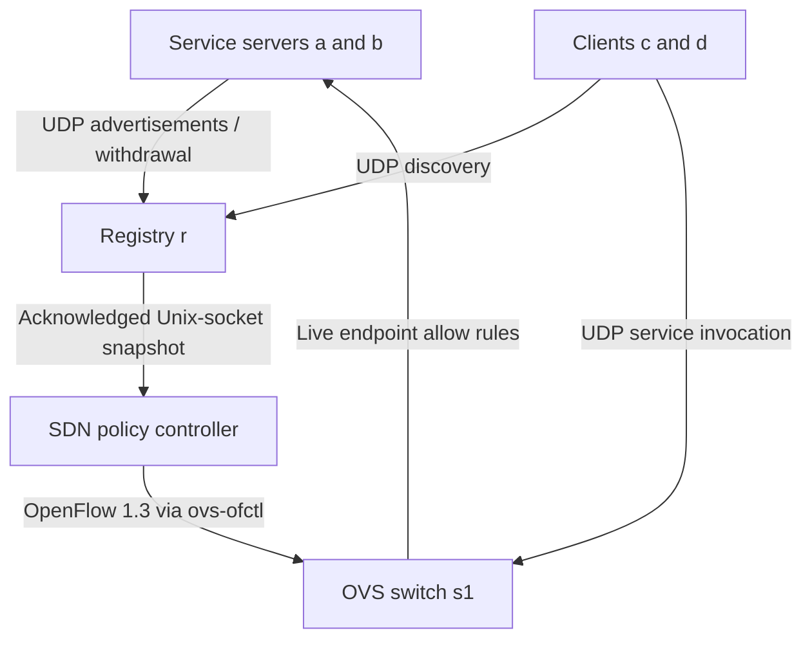

# Project 21: UDP Service Discovery with SDN

## Verified results included

This edition includes 31 student-executed Mininet runs (3,720 attempts) from
Ubuntu 24.04.4 on WSL 2. See `docs/REPORT.md` for measured results and limits.
Run `python3 analyze_results.py` to reproduce the analysis. Raw experiment files
are preserved under `results/`. GitHub publication is still pending.


A reproducible mini project for **SDN-Socket Programming – Jackfruit**.
Servers advertise a named UDP service; clients query a lease-based registry and
invoke the discovered service. An out-of-band policy controller translates registry
state into OpenFlow 1.3 rules on Open vSwitch.

## Start here

Use your Ubuntu VM (20.04/22.04 per the supplied course guide). The application uses
Python's standard library; Mininet and OVS are system packages.

```bash
sudo apt update
sudo apt install -y mininet openvswitch-switch python3 git tcpdump
sudo systemctl start openvswitch-switch
cd service-discovery
python3 -m unittest discover -s tests -v
sudo /usr/bin/python3 topology.py --mode dynamic
```

Run from the repository root. Do not use a Python virtual environment for the
Mininet runner unless it can import the system Mininet package.
At `mininet>`:

```text
pingall
c python3 app/client.py --count 10 --output results/client-c.csv
d python3 app/client.py --count 10 --output results/client-d.csv
sh ovs-ofctl -O OpenFlow13 dump-flows s1
exit
```

Expected: client CSVs contain `success=1`, discovery latency and call latency.
The supplied student results demonstrate this behavior under WSL 2. A fresh
installation should still run this check; development/review tests were separate.
If a previous run crashed, use `sudo mn -c` before restarting. This cleans up
Mininet resources; do it only when no other Mininet experiment is running.

## Architecture



All five hosts connect to a single 10 Mbps switch, with 2 ms configured on each
host link. Hosts are `r=10.0.0.1`, `a=.2`, `b=.3`, `c=.4`, `d=.5`.
Registry discovery uses UDP 9999. Echo servers use UDP 10001 and 10002.
Two clients may run simultaneously; servers multiplex heartbeat and service I/O
with bounded socket waits. The registry serializes small datagrams in an event loop.

### How the SDN controller works

`sdn/controller.py` is a separate local controller process. It uses `ovs-ofctl`
to issue OpenFlow operations over OVS's local management socket. It does **not**
use Ryu, POX, or a persistent remote TCP controller. `controller=None` in Mininet
therefore means no Mininet-managed remote controller; it does not mean that this
project lacks policy control. Confirm this local OpenFlow controller architecture
is acceptable if your instructor specifically requires Ryu/POX.

The registry sends full endpoint snapshots over a local Unix stream socket with
permissions 0600. Mininet shares the filesystem, so namespace isolation does not
prevent this out-of-band channel. Each reply waits for acknowledged switch rule
updates. This deliberately includes control overhead in discovery latency.

| Priority | Match | Action |
|---|---|---|
| 200 | UDP to a registered server IP and port | NORMAL; expires after 3 s without refresh |
| 100 | UDP destination ports 10000–10015 | DROP, dynamic mode only |
| 0 | Other traffic, including ARP and UDP 9999 | NORMAL |

The controller only allows endpoints on server IPs `.2` and `.3` in the reserved
port range. Registry sync refreshes allow rules every approximately 0.5 s and
on application messages. On expiry or withdrawal, exact endpoint rules are deleted.
All flow commands must finish successfully before the controller acknowledges. If controller
updates fail, the registry withholds replies; old allow rules expire within 3 s.
Already in-flight packets are not recalled. Return traffic uses NORMAL forwarding.

This is dynamic filtering/recovery, not rerouting or controller-level load balancing.
Clients alternate across discovered endpoints. The topology has one path; it
cannot demonstrate alternate-path link recovery.

## Automated experiments

```bash
sudo /usr/bin/python3 topology.py --mode static --experiment normal --out results/static-normal
sudo /usr/bin/python3 topology.py --mode dynamic --experiment normal --out results/dynamic-normal
sudo /usr/bin/python3 topology.py --mode static --experiment failure --out results/static-failure
sudo /usr/bin/python3 topology.py --mode dynamic --experiment failure --out results/dynamic-failure
sudo /usr/bin/python3 topology.py --mode dynamic --experiment loss --out results/dynamic-loss
sudo /usr/bin/python3 topology.py --mode dynamic --experiment churn --out results/dynamic-churn
python3 summarize.py results/static-normal results/dynamic-normal results/static-failure results/dynamic-failure results/dynamic-loss results/dynamic-churn
```

Repeat each configuration at least five times with distinct output directories.
Use `--count 200` for longer runs. `failure` SIGKILLs server a after 2 s;
`churn` also restarts it after the expiry and stale-probe steps. `loss` adds
10% egress loss to the two client links after registration. It does not model
10% loss on every link or both directions independently.
Each run saves per-client CSVs, process logs, experiment metadata, and flow dumps.

The failure/churn experiments send 100 deliberate datagrams to the stale endpoint
once its lease has expired. Compare `flows-after-expiry.txt` and
`flows-after-stale-probe.txt`: the dynamic drop rule's packet count should increase.
For static mode, the priority-0 NORMAL count includes the probes and other traffic.
Use packet capture at the failed server's interface for an unambiguous comparison:

```text
a tcpdump -n -i a-eth0 udp dst port 10001
```

Run capture in a second terminal or background it in the interactive demo; see
`docs/DEMO.md`. Sending a packet is not proof of SDN enforcement—use counters/capture.

## Protocol

Messages are UTF-8 JSON dictionaries, maximum receive size 8192 bytes, version
`v=1`. Request correlation uses random `xid`; client responses must match both
source IP/port and xid. The registry derives endpoint IP from the datagram source,
never an advertised IP field. Advertisements and withdrawals are idempotent.

```json
{"v":1,"xid":"unique-id","op":"advertise","service":"echo","port":10001}
```

Other operations: `withdraw` with the same fields; `discover` with `service`;
`call` with `payload`. Registry replies include `ok` and optionally `services`.
Service replies include `ok`, `result`, and `server`. Servers refresh every 0.7 s;
registry TTL is 3 s using a monotonic clock. Expiry is checked on each message and
at 0.2 s receive-loop intervals when the controller is responsive.
Clients retry up to three times at 0.4 s per attempt. UDP does not guarantee delivery,
order, or exactly-once processing; echo is safe to retry. Malformed messages are
ignored and logged. Empty discovery results return an empty service list.
There is no generic registry pagination; this lab is designed for a small service set.

## Files and submission

| File | Purpose |
|---|---|
| `app/registry.py` | Advertisement registry, TTL expiry and SDN synchronization |
| `app/server.py` | Concurrent heartbeat and UDP echo service |
| `app/client.py` | Retrying discovery/invocation with measured CSV output |
| `app/probe.py` | Stale endpoint traffic for SDN enforcement validation |
| `sdn/controller.py` | Dynamic OpenFlow policy, static baseline |
| `topology.py` | Mininet setup, process lifecycle, experiment scenarios |
| `summarize.py` | Aggregate success rate and latency percentiles |
| `tests/test_system.py` | Unit and localhost UDP integration tests |
| `docs/REPORT.md` | Report framework, rubric mapping and evaluation method |
| `docs/DEMO.md` | D1/D2 demo and viva preparation |
| `docs/VALIDATION.md` | What was actually tested and remaining checks |

To publish after extracting this folder (replace YOUR_USERNAME):

```bash
git init
git add .
git commit -m "Implement UDP service discovery with dynamic SDN filtering"
git branch -M main
git remote add origin https://github.com/YOUR_USERNAME/sdn-service-discovery.git
git push -u origin main
```

Create an empty GitHub repository first. Results are ignored by default: after
reviewing them, explicitly add selected experiment folders with
`git add -f results/dynamic-normal` etc. Never commit Unix sockets or caches.
No GitHub repository has been created or published as part of this package.

## Limitations

This is a trusted teaching LAN. There is no cryptographic advertisement
authentication, TLS, rate limiting, persistent registry storage, registry redundancy,
or production multi-tenant isolation. Source-IP inference is not authentication.
Only reserved UDP service ports are gated. A failed registry/controller is an
availability failure; allow rules fail closed after their hard timeout, while
unrelated traffic keeps forwarding. Each accepted message triggers OpenFlow tools,
which is simple and auditable but not suitable for high-throughput discovery.
Registry TTL can temporarily expose a crashed endpoint until expiry. Clients
rediscover on their next sample rather than transparently retrying another server
within the same sample. Oversized registry responses are outside this lab's scope.

## References

- Supplied course file: Mininet Installation Guide on UBUNTU.docx.pdf.
- Mininet walkthrough: https://mininet.org/walkthrough/
- Open vSwitch OpenFlow FAQ: https://docs.openvswitch.org/en/stable/faq/openflow/
- ovs-ofctl reference (flow syntax, cookies and timeouts): https://www.openvswitch.org/support/dist-docs/ovs-ofctl.8.html
